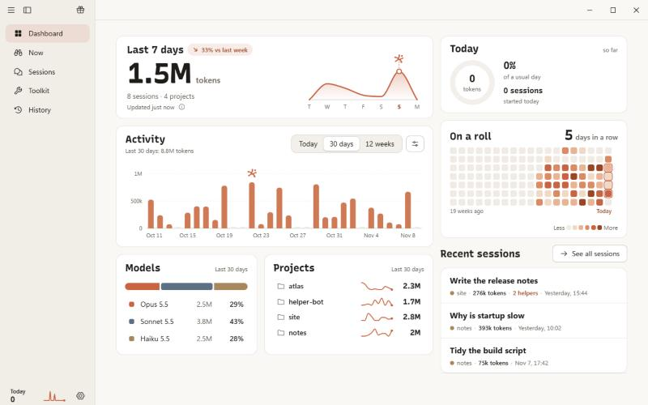
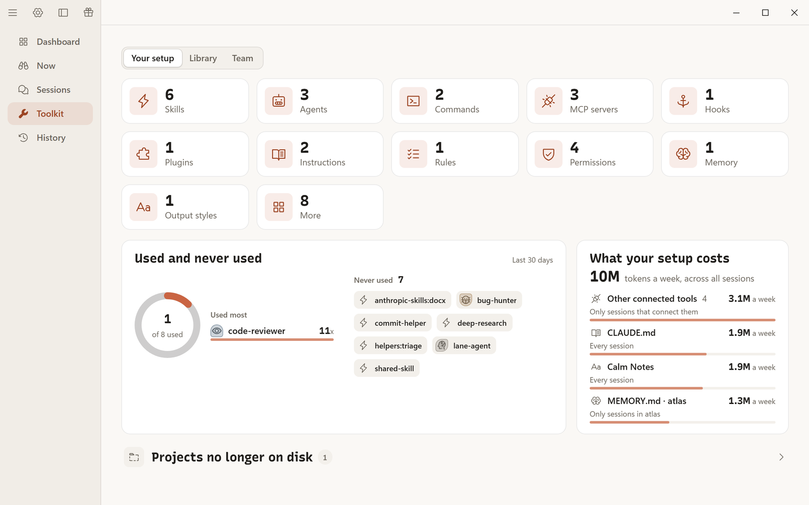
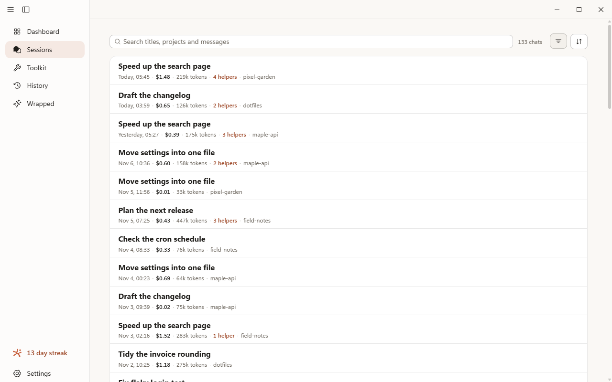
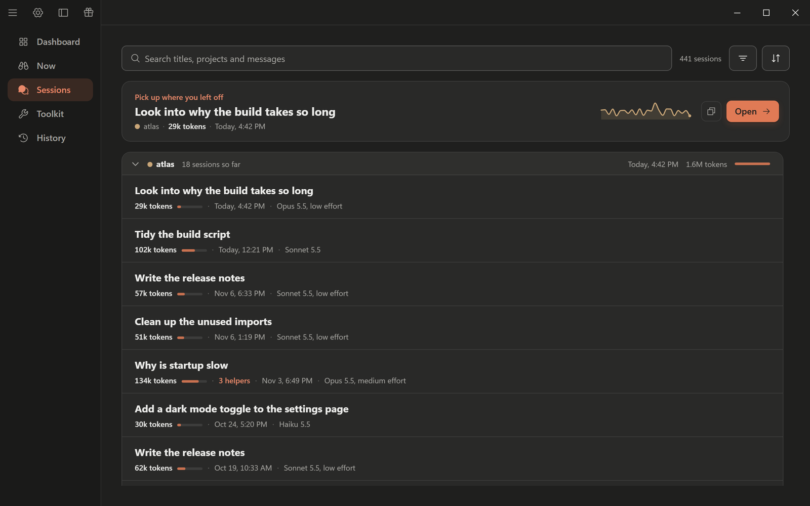
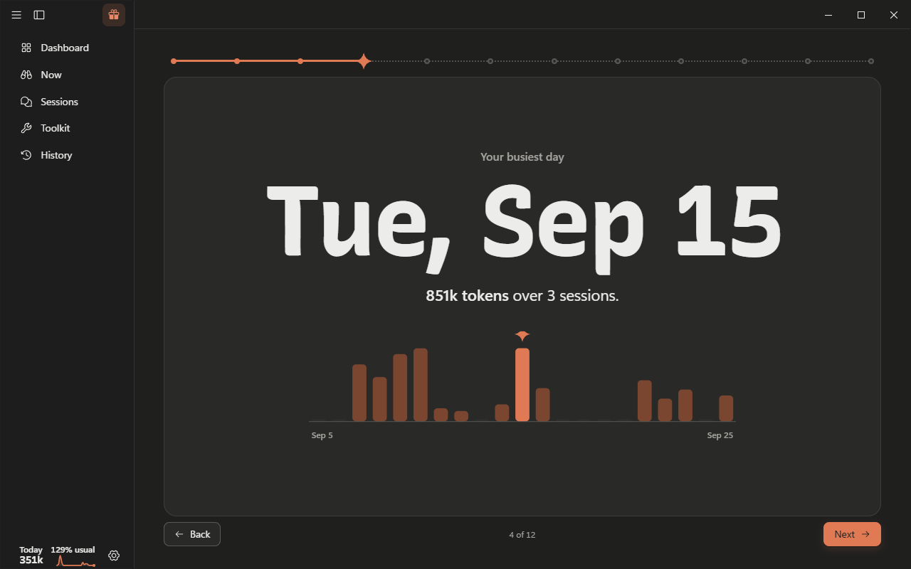

<div align="center">


# Atlas

**The toolbox that makes Claude Code better.**

<a href="https://github.com/dozeyy/atlas/releases/latest"></a>

[Windows](https://github.com/dozeyy/atlas/releases/latest/download/Atlas-Setup-Windows-x64.exe) &nbsp;|&nbsp; [macOS](https://github.com/dozeyy/atlas/releases/latest/download/Atlas-macOS.dmg) &nbsp;|&nbsp; [Claude Code skill](#install-the-atlas-skill) &nbsp;|&nbsp; [All releases](https://github.com/dozeyy/atlas/releases)

</div>

<p align="center"></p>

Atlas is a desktop app and a Claude Code plugin that work together. The app shows you where
your Claude Code usage goes and lets you manage every file in your Claude Code setup without
losing any of it. The plugin brings the same numbers into any chat (`/atlas`), and a small
connector lets Claude Code itself help look after your skills, agents and rules, with a backup
before every change.

Everything stays on your computer. Atlas only reads what Claude Code already keeps there.

This repository holds the downloads, the plugin and the documentation. The app's source code
is not published here.

## What is in the box

| Piece | What it does |
|---|---|
| **Atlas app** (Windows, macOS) | Dashboard, live view of running chats, searchable sessions, a Toolkit of everything in your setup, History with undo, a Wrapped year story, a tray readout. |
| **The `/atlas` skill** (Claude Code plugin) | Your usage in the chat: this chat, today, a week, a month, one project, or two periods side by side. |
| **The Atlas connector** (MCP server, comes with the app) | Lets Claude Code list and edit your skills, agents, commands, rules and more through Atlas, so every change is backed up and shows in History. |

## Screenshots

| | |
|---|---|
|  |  |
| **Now**: what is running, what is waiting for you, what just finished. | **Sessions**: every chat with its tokens, cost estimate and helpers. Search titles, projects and messages. |
|  |  |
| **Light, dark and silver** themes, or follow Windows and macOS. | **Wrapped**: your year as a short, quiet story, with a recap card you can save as an image. |

The names and numbers in these pictures come from a made-up demo setup, not a real account.

## Download

Get the latest build from the [Releases page](https://github.com/dozeyy/atlas/releases/latest).

| Computer | File |
|---|---|
| Windows 11 (64-bit) | [`Atlas-Setup-Windows-x64.exe`](https://github.com/dozeyy/atlas/releases/latest/download/Atlas-Setup-Windows-x64.exe) |
| Mac, Apple Silicon and Intel (macOS 12 or newer) | [`Atlas-macOS.dmg`](https://github.com/dozeyy/atlas/releases/latest/download/Atlas-macOS.dmg) |

Every release also lists a `SHA256SUMS.txt` so you can check your download.

Atlas is not code signed yet, so the first run shows a warning. That is expected:

- **Windows:** SmartScreen says "Windows protected your PC". Click **More info**, then **Run anyway**.
- **macOS:** the Mac stops it once. Follow the short steps in [Installing on a Mac](docs/macos-install.md).

Atlas updates itself from inside the app (Settings, About). It checks quietly and never installs
by itself: a small download icon appears when an update is ready.

## Install the Atlas skill

In Claude Code, run:

```
/plugin marketplace add dozeyy/atlas
/plugin install atlas@atlas
```

Then type `/atlas`, or just ask "what's my usage this week".

There is nothing else to set up. The first time, the skill finds the `atlas-usage` program that
comes with the app, or downloads the right build for your computer once and checks it against a
checksum that is fixed inside the plugin. A download that does not match is deleted and never
run. It also checks that the release's checksum list is signed by the Atlas release key. To see
which copy it uses, ask Claude to run `launcher-doctor`. Details are in
[the skill guide](docs/skill.md).

You can install the skill without the app. It works in Claude Code in the terminal, the desktop
app's Code tab and the IDE extensions. It does not work in claude.ai web chat, because it reads
files that only Claude Code keeps on your computer.

## What the skill can do

| You type | You get |
|---|---|
| `/atlas` | This chat: tokens, helpers (subagents) apart from the main chat, model mix, activity. |
| `/atlas today`, `yesterday` | One day. |
| `/atlas this week`, `last week` | A week, with activity per day. |
| `/atlas 7d`, `30d`, `<N>d` | A rolling range. 15 days or more draws the terrain grid. |
| `/atlas this month`, `last month` | Longer ranges. |
| `/atlas all time` | Your all-time stats: every chat Atlas has counted, even ones Claude Code has since cleaned up. Add `this project` for one project. |
| `/atlas 2026-11-02..2026-11-07` | A date range. |
| `/atlas this project` | The same, for the current folder's project. |
| `/atlas last week vs this week` | Two periods side by side, with the change, by model and by project. |

A sample, as it appears in the chat:

````text
**This week** · Nov 8 · all projects
**560k tokens** plus 3.85M cache reads · 3 sessions

Models
```text
Sonnet 5.5  ████████████████████████  364k  65%
Haiku 5.5   ████████████▉             196k  35%
```

| Project | Tokens | Sessions |
|---|--:|--:|
| maple-api | 373k | 2 |
| dotfiles | 187k | 1 |

_Estimated at API prices: $2.02. Not a bill._
````

Tokens are the figure: input, output and cache writes. Cache reads are shown apart. The one
dollar number at the end is an estimate at API prices, not a charge. Every scope, with a full
sample of each, is in [the skill guide](docs/skill.md).

## The Atlas connector (MCP tools)

The app ships a small MCP server, `atlas-mcp`. In the app, Settings, Claude Code, **Connect**
registers it with Claude Code in one click (it runs Claude Code's own `claude mcp add-json`
command). Open a new chat and Claude can use these tools:

| Tool | Writes | What it does |
|---|---|---|
| `list_items` | no | Lists everything in your setup, filtered by kind, scope, project or a search word. |
| `read_item` | no | Shows the text of one item. Secret-looking values are shown as dots. |
| `create_item` | yes | Makes a new skill, agent, command, rule, output style, hook, MCP server or CLAUDE.md. Never replaces an existing one. |
| `update_item` | yes | Replaces an item's text. Refused if the file changed since it was read. |
| `rename_item` | yes | Renames a skill, agent, command, rule or output style. |
| `delete_item` | yes | Moves an item into Atlas's backups, where it can be restored exactly. |
| `toggle_hook` | yes | Turns a hook off (parked safely in a backup) or back on where it was. |
| `toggle_mcp_server` | yes | Turns an MCP server off or on for a project. |
| `get_usage_summary` | no | Tokens, estimated cost, per model, top projects and chats for a period. |
| `list_backups` | no | Lists backups, newest first, and who made them. |
| `restore_backup` | yes | Undoes a change from a backup. Refuses to overwrite a file that changed again since. |

Safety rules built into the connector:

- It talks to Claude Code over a pipe. It never opens a network port.
- It can only reach files inside your Claude folder and your known project folders.
- It never lists, reads or writes your sign-in files (`.credentials.json`, session keys, OAuth or admin keys).
- Edits made this way are limited to plain text items (instructions, rules, output styles and
  markdown skills, agents and commands). Anything that can run code, such as hooks, MCP servers,
  permissions and settings, is never written directly by the connector.
- Every change makes a backup first, is labelled in History as made by Claude, and can be undone.

## Skill alone, or with the app

| | Skill only | With the app |
|---|:-:|:-:|
| `/atlas` usage in the chat (all scopes, comparisons) | yes | yes |
| Same numbers as the app | yes | yes |
| Dashboard, Now, Sessions, search | no | yes |
| Toolkit: see every skill, agent, hook, rule and MCP server, and what your setup costs | no | yes |
| Safe editing with backups, History and Undo | no | yes |
| Claude Code helping manage your setup (the connector) | no | yes |
| Wrapped year story and recap card | no | yes |
| Tray readout | no | yes |

## Privacy

- **All local.** Atlas reads the chat transcripts and config files Claude Code already keeps in
  your Claude folder (`~/.claude`, or the folder in `CLAUDE_CONFIG_DIR`). Your chats are never uploaded.
- **No telemetry, no account, no analytics.** Atlas has no server.
- **The one network call** is the update check: the app asks `github.com` for this repository's
  newest `latest.json` after it starts and every six hours. Nothing about you is sent beyond what any web
  request carries. The skill's one-time download of the `atlas-usage` program also comes from this
  repository's releases.
- **Never read:** your sign-in credentials (`.credentials.json`), session key files, OAuth keys.
- **Read-only by default.** The usage views only read. Anything that changes a file makes a
  backup first, writes safely, and can be undone.
- **Cost figures** are estimates from a built-in price table, not a bill.

More in [docs/privacy.md](docs/privacy.md).

## Requirements

- **Claude Code** with some chat history on this computer (the numbers come from it).
- **App:** Windows 11 (64-bit) or macOS 12 or newer. On Windows the app needs Microsoft Edge
  WebView2, which Windows 11 includes.
- **Skill:** Windows, macOS or Linux (x64; Apple Silicon and Intel on macOS), plus a Claude Code that supports plugins.
- Disk: the first run builds a small index of your chats in Atlas's own data folder. A few GB of
  transcripts take about a minute the first time; after that it is quick.

## FAQ

**Does Atlas work in claude.ai in the browser?**
No. It reads files that Claude Code keeps on your computer, and the browser chat keeps none.

**Does it work in the Claude desktop app?**
Yes, in the Code tab, which is Claude Code. Plain chats in the desktop app are not stored locally, so Atlas cannot see them.

**Is the dollar figure my real bill?**
No. It is an estimate at public API prices. If you are on a subscription plan, you do not pay that.

**Why does my usage look lower than I expected?**
Claude Code deletes old chat files after `cleanupPeriodDays` (30 days by default). Once Atlas has
counted a chat it keeps that chat's numbers in its own index, so all-time totals keep growing after
Claude Code deletes the file. What Atlas cannot count are chats that were already deleted before it
first ran. To keep more of those, raise `cleanupPeriodDays` in your Claude Code settings before you
install, and run `/atlas` (or open the app) now and then so new chats are counted before they go.

**Do the skill and the app have to match versions?**
They are released together under one version number. The skill fetches the matching build by itself when you update the plugin.

**Can Atlas break my Claude Code setup?**
It is built not to: every write makes a backup first, writes atomically, keeps the file's line endings and unknown keys, and shows up in History where you can undo it. Atlas never touches your sign-in files.

## Troubleshooting

| What you see | What to do |
|---|---|
| `atlas-usage:` line with "could not download" | Check your internet connection and try again. The download comes from this repository's releases. |
| "this copy of the skill has no version" | Install the plugin with `/plugin install atlas@atlas` instead of copying the folder by hand. |
| A checksum message | The download did not match the plugin's pinned checksum and was deleted on purpose. Update the plugin (`/plugin marketplace update atlas`) and try again. If it persists, [open an issue](https://github.com/dozeyy/atlas/issues). |
| "not signed by the Atlas key" or "does not list this program" | The release's signed checksum list did not back up the download, so it was deleted and not run. Try again later, or update the plugin. If it persists, [open an issue](https://github.com/dozeyy/atlas/issues). |
| The skill runs the wrong copy, or can't find one | Ask Claude to run the launcher with `launcher-doctor`. It lists each place it looks, what it found and which copy it would run, and runs nothing. To force one program, set `ATLAS_USAGE_BIN` to its path. |
| "No release yet" for this plugin version | The matching program is not published for that version yet. Update the plugin, or install the app, which includes it. |
| Chart shows boxes or question marks | Ask for plain bars: `/atlas this week --ascii`, or set `ATLAS_ASCII=1`. |
| The first `/atlas` run takes a while | It is indexing every chat once. Later runs take under a second. |
| Claude asks permission to use the skill | Allow it once, or add `Skill(atlas)` to `permissions.allow`. Typing `/atlas` needs no approval. |
| The Mac will not open Atlas | See [Installing on a Mac](docs/macos-install.md). |
| Windows SmartScreen warns | Click More info, then Run anyway. Atlas is not code signed yet. |
| The connector says "moved" | You moved or reinstalled Atlas. Click Reconnect in Settings, Claude Code. |

## Uninstall

- **Skill:** `/plugin uninstall atlas@atlas`, and `/plugin marketplace remove atlas` if you also want the marketplace gone.
  The program it downloaded stays in a cache folder: `%LOCALAPPDATA%\atlas\skill` on Windows,
  `~/Library/Caches/atlas/skill` on macOS, `~/.cache/atlas/skill` on Linux. Delete it too if you want it gone.
- **Connector:** Settings, Claude Code, **Disconnect** in the app (or `claude mcp remove -s user atlas`).
- **App on Windows:** Settings, Apps, Installed apps, Atlas, Uninstall.
- **App on macOS:** drag Atlas from Applications to the Trash.
- **Your Atlas data** (the chat index, settings and backups) lives in a folder named `atlas` inside
  your user data folder (on Windows under `AppData`, on macOS in `~/Library/Application Support`). Delete it if you want
  Atlas gone completely. Your Claude Code files are never part of it.

## Changelog

See [CHANGELOG.md](CHANGELOG.md) and the [release notes](https://github.com/dozeyy/atlas/releases).

## License

The Atlas plugin in [`skill/`](skill/) is released under the [MIT License](LICENSE).

The Atlas app and its installers and binaries (the files attached to releases) are
**All rights reserved**, copyright 2026 Will Henry.

## Credits

Made by Will Henry. Atlas is an independent project and is not affiliated with Anthropic.
"Claude" and "Claude Code" are trademarks of Anthropic.
